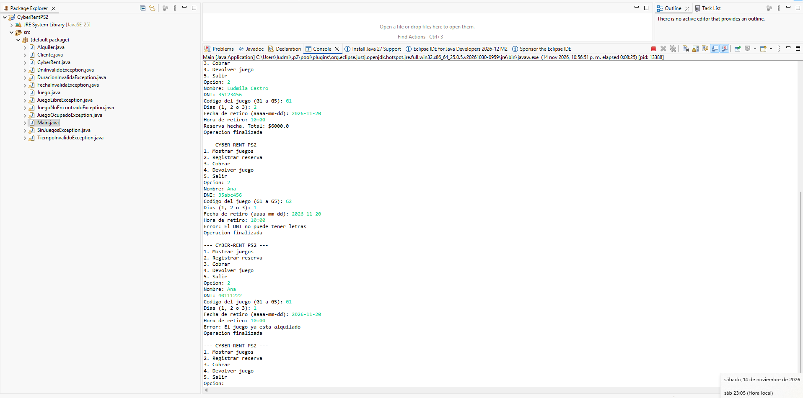

# CYBER-RENT-PS2

## Integrantes
- Ludmila Castro (ludmicastro6530-crypto)
- Brisa Constante (constantepintob-debug)

## Nombre del programa
CYBER-RENT-PS2

## Descripción del proyecto
Cyber-Rent PS2 es un local donde se alquilan juegos de PlayStation 2. Tenemos los 5 juegos más jugados de esa época: GTA San Andreas, God of War II, Resident Evil 4, DBZ Budokai Tenkaichi 3 y Shadow of the Colossus. El cliente elige un juego, lo reserva por 1, 2 o 3 días y lo retira en el local mostrando su DNI.

## Problema
Si las reservas se anotan a mano es fácil equivocarse: se puede escribir mal un DNI, reservar un juego que ya está alquilado o dar un turno para un día que ya pasó. Nuestro programa revisa los datos de cada reserva y, si algo está mal, muestra un mensaje explicando el error en vez de cerrarse.

## Solución propuesta
### Tema elegido
Clase 9: Excepciones.

Lo elegimos porque en un sistema de reservas el cliente puede cargar muchos datos mal, y justamente las excepciones sirven para manejar esos errores sin que el programa se rompa.

Lo que usamos del tema:
- try / catch / finally para atrapar los errores.
- Excepciones creadas por nosotras para los errores del negocio: DniInvalidoException, JuegoOcupadoException, JuegoNoEncontradoException, JuegoLibreException, FechaInvalidaException, DuracionInvalidaException, SinJuegosException y TiempoInvalidoException.
- throw y throws para lanzar los errores desde los métodos.

## Herramientas y tecnologías utilizadas
Java, Eclipse, GitHub y Trello

## Enlace del tablero
https://trello.com/b/TyL6jqW1/grupo-3-cyber-rent-ps2

## Instrucciones para ejecutar
1. Descargar el repositorio (Code, Download ZIP) y extraerlo.
2. En Eclipse: File, New, Java Project. Destildar "Create module-info.java file".
3. Copiar los archivos de la carpeta src del repositorio y pegarlos en la carpeta src del proyecto.
4. Clic derecho en Main.java, Run As, Java Application.
5. El menú aparece en la consola. La fecha se escribe así: aaaa-mm-dd.

## Funcionalidades
- Ver los juegos y si están disponibles.
- Reservar un juego.
- Calcular el precio según los días: 1 día $4.000, 2 días $6.000, 3 días $9.000.
- Cobrar y mostrar el ticket.
- Devolver un juego para que quede libre otra vez.
- Avisar cuando un dato está mal.

## Capturas de pantalla
Reserva bien hecha, DNI con letras y juego ya alquilado:

Cobrar y devolver:

## Pruebas realizadas
Hicimos 14 pruebas y pasaron todas. La tabla con los resultados está en [pruebas/casos-de-prueba.md](pruebas/casos-de-prueba.md) y las capturas en la misma carpeta.

## Documentación
El análisis y el diseño están en la carpeta /docs y el avance de cada día en [bitacora.md](bitacora.md).

## Sobre el grupo
Al principio el grupo 3 tenía cuatro integrantes. El trabajo lo hicimos nosotras dos, y la profesora indicó que figuren solo quienes trabajaron.

## Fuentes
Apuntes de la clase 9 de AED2.

## Estado del proyecto
Terminado. El programa compila, se ejecuta y pasó todas las pruebas.

## Conclusiones
Aprendimos a crear excepciones propias y a usar try, catch y finally para que el programa avise los errores sin cerrarse. Lo que más nos costó fue organizarnos al principio, subir archivos a carpetas en GitHub y ponernos de acuerdo en qué excepciones usar. Si lo hiciéramos de nuevo, armaríamos el tablero y repartiríamos las tareas desde el primer día.
