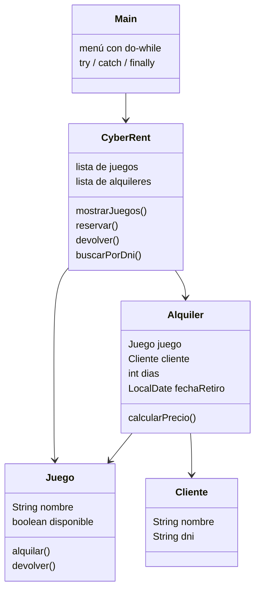

# Diseño - Cyber-Rent PS2

En este archivo está el plano del programa: qué clases tiene, cómo funciona el menú y dónde se usan las excepciones.

## 1. Clases

- **Juego:** cada juego del local. Sabe si está libre o alquilado.
- **Cliente:** la persona que alquila, con su nombre y DNI. El DNI lo guardamos como String porque no hacemos cuentas con él y necesitamos revisar si tiene letras.
- **Alquiler:** una reserva. Une un juego con un cliente, guarda los días y la fecha de retiro, y calcula el precio (1 día $4.000, 2 días $6.000, 3 días $9.000).
- **CyberRent:** es la clase que maneja el local. Tiene todos los juegos y los alquileres. Revisa los datos de cada reserva y, si algo está mal, arroja una de nuestras excepciones con throw.
- **Main:** el menú que usa el empleado.

## 2. Cómo funciona el menú (Main.java)

El menú se repite con un do-while hasta que el empleado elige salir. Para leer lo que escribe usamos Scanner.

En el Main no revisamos los datos con if: cada opción llama a un método de CyberRent dentro de un try. Si ese método arroja una excepción, la atendemos en el catch, mostramos el mensaje y el menú sigue funcionando. En el finally mostramos "Operación finalizada", haya salido bien o mal.

Opciones del menú:

1. **Ver juegos:** muestra los 5 juegos y si están libres o alquilados.
2. **Reservar un juego:** pide nombre, DNI, juego, días y fecha de retiro. Llama a reservar(). Puede arrojar:
   - DniInvalidoException si el DNI no tiene 7 u 8 números.
   - JuegoNoDisponibleException si el juego ya está alquilado.
   - DuracionInvalidaException si los días no son 1, 2 o 3.
   - FechaInvalidaException si la fecha de retiro ya pasó.
   Si todo está bien, guarda la reserva y muestra el total a pagar.
3. **Devolver un juego:** pide el nombre del juego y lo vuelve a dejar libre. Si ese juego no estaba alquilado, arroja JuegoNoDisponibleException con el mensaje "Ese juego no estaba alquilado".
4. **Buscar reservas por DNI:** muestra los alquileres de ese cliente. Si el DNI está mal escrito, arroja DniInvalidoException.
5. **Salir:** termina el programa.

Si el empleado escribe letras cuando el menú pide un número, Java arroja InputMismatchException. También la atendemos en un catch para que el programa no se corte.

## 3. Dónde se arrojan y dónde se atienden las excepciones

Como vimos en clase, una excepción se puede atender en el mismo método o arrojarla "hacia arriba" con throws para que la atienda el que llamó al método. Nosotras elegimos arrojarlas hacia arriba:

- Los métodos de CyberRent tienen throws en su firma, por ejemplo:
  `reservar(...) throws DniInvalidoException, JuegoNoDisponibleException, FechaInvalidaException, DuracionInvalidaException`
- El Main los llama dentro de un try y tiene un catch distinto para cada excepción, así cada error muestra su propio mensaje.

Lo elegimos así para que la clase del local se ocupe de las reglas del negocio y el menú se ocupe de hablar con el empleado.

